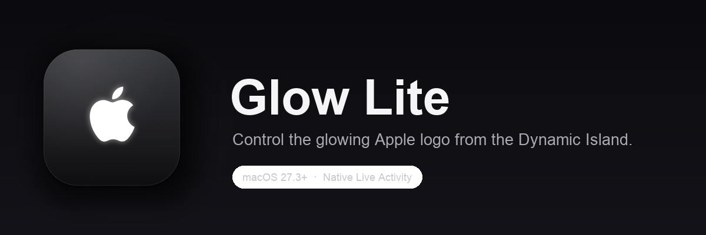
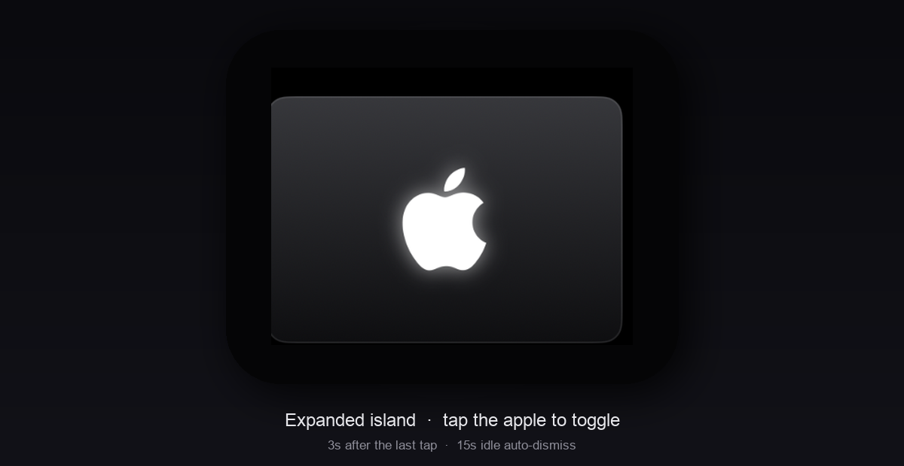
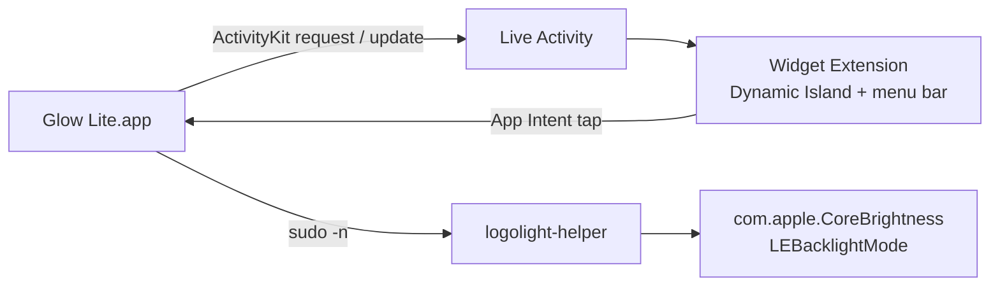

<p align="center">
  
</p>

<p align="center">
  <a href="https://github.com/Lostnal/glow-lite/releases"></a>
  
  
  
</p>

<p align="center">
  <b>Toggle the glowing Apple logo on a PROLED XDR MacBook Pro —<br>right from the macOS Dynamic Island.</b>
</p>

<p align="center">
  <a href="README.zh-CN.md">中文说明</a> ·
  <a href="docs/RELEASE.md">Release guide</a> ·
  <a href="CONTRIBUTING.md">Contributing</a>
</p>

---

## Demo

<p align="center">
  
</p>

Glow Lite is a small native macOS app built on **ActivityKit** and **WidgetKit**. It publishes a Live Activity, so the control lives in the system **Dynamic Island** — no custom floating window, no private APIs.

## Features

- **Native Live Activity** — compact and expanded presentations rendered by the system.
- **One control** — tap the Apple in the expanded island to toggle the light.
- **Predictable timing** — dismisses 3 seconds after the last tap; 15 seconds of inactivity also dismisses it.
- **Dock or menu bar** — keep the app in the Dock, or run it as a menu-bar-only accessory.
- **Finish preview** — preview space black / silver enclosure colors, or follow the current Mac.
- **Offline by design** — no network access, no analytics, no telemetry.

## Requirements

| | |
| --- | --- |
| OS | **macOS 27.3+** (currently in beta) |
| Hardware | Apple Silicon + a **PROLED XDR** MacBook Pro for the visible light effect |
| Build | **Xcode 27.3+** with the macOS 27.3 SDK |
| Signing | An **Apple Development** certificate for the Widget Extension |

> On Macs without the PROLED XDR display the app still runs, but toggling the light has no visible effect.

## Install

There are no prebuilt binaries yet — build from source. This also keeps the signing story transparent: the Live Activity extension must be signed to load.

```bash
git clone https://github.com/Lostnal/glow-lite.git
cd glow-lite

DEVELOPER_DIR=/Applications/Xcode-beta.app/Contents/Developer \
CODESIGN_ID="Apple Development: Your Name (TEAMID)" \
./build.sh

ditto "dist/Glow Lite.app" "/Applications/Glow Lite.app"
open "/Applications/Glow Lite.app"
```

- `build.sh` auto-detects Xcode 27.3+ (or set `DEVELOPER_DIR` / `XCODE_APP`).
- `CODESIGN_ID` defaults to ad-hoc. An ad-hoc build can run, but the **Widget Extension may not be loaded**, so the island will not appear.
- Find your identity with `security find-identity -v -p codesigning`.

## Usage

1. Click the **Glow Lite** Dock icon (or the menu bar icon) to start/refresh the Live Activity.
2. The island appears in the compact state; tap it to expand.
3. Tap the **Apple** to switch the light on/off.
4. It dismisses **3 seconds after your last tap**, or after **15 seconds** with no interaction.
5. Right-click the Dock icon for the opposite action, settings, and quit.

## How it works



The actual command is the documented Apple switch:

| Action | Command |
| --- | --- |
| Off | `sudo defaults write com.apple.CoreBrightness LEBacklightMode -int 0` |
| On | `sudo defaults delete com.apple.CoreBrightness LEBacklightMode` |

The helper performs read → toggle → verify inside a single root process, so the UI and the hardware state cannot drift apart.

## Security

The first launch asks for an administrator password once and installs a small helper:

| Path | Purpose |
| --- | --- |
| `/usr/local/libexec/logolight-helper` | root-owned script; accepts only `read` / `toggle` |
| `/private/etc/sudoers.d/logolight` | `your-user ALL=(root) NOPASSWD: /usr/local/libexec/logolight-helper` |

The sudoers file is validated with `visudo -cf` during installation. If you decline, the app falls back to asking for authorization on every toggle.

To remove everything:

```bash
sudo rm -f /usr/local/libexec/logolight-helper /private/etc/sudoers.d/logolight
```

See [SECURITY.md](SECURITY.md) for the threat model and reporting instructions.

## Build

```bash
DEVELOPER_DIR=/Applications/Xcode-beta.app/Contents/Developer \
CODESIGN_ID="Apple Development: Your Name (TEAMID)" \
./build.sh
```

The script compiles the app and the Widget Extension, generates `Metadata.appintents` for both targets (without it, the island button is inert), signs the bundle, and writes `dist/Glow Lite.app`.

## Distribution

Direct binary distribution needs an **Apple Developer Program** membership and a **Developer ID Application** certificate. `release.sh` performs the full flow: Developer ID build → DMG → notarization (`notarytool`) → stapling → Gatekeeper verification.

```bash
CODESIGN_ID="Developer ID Application: Your Name (TEAMID)" \
NOTARY_PROFILE="glow-lite" \
./release.sh
```

See [docs/RELEASE.md](docs/RELEASE.md). Mac App Store distribution is not possible: the app needs root and installs a sudoers rule.

## Limitations

- The expanded Dynamic Island is **system-controlled**; apps cannot force it open. The app starts the activity, then the user taps to expand.
- The system draws the expanded card with its own fixed margins; a 31:21.6 lid cannot have equal top/bottom and left/right margins inside it.
- The 15-second timer starts when the activity is shown; expand/collapse gestures are not exposed to apps.
- macOS 27.3 is in beta; Live Activity behavior may change before release.
- Tested only on Mac17,13 (M5 Pro, PROLED XDR).

## FAQ

**The island never appears.**
The Widget Extension is probably not signed or not registered. Use an Apple Development certificate, then rebuild and run `pluginkit -a "…/GlowWidget.appex"`.

**The logo does not change.**
Your Mac likely lacks the PROLED XDR display. The command is accepted but has no visible effect on other models.

**Why does it ask for an admin password?**
It installs the fixed helper described in [Security](#security). You can decline and use per-click authorization instead, or uninstall it at any time.

**Does it work on Intel or macOS 26?**
No. It is arm64-only and requires macOS 27.3+.

## Contributing

Issues and pull requests are welcome. Please read [CONTRIBUTING.md](CONTRIBUTING.md) first, and include your macOS version, Mac model, and Xcode version in bug reports.

## License

[MIT](LICENSE).

## Disclaimer

Not affiliated with, endorsed by, or sponsored by Apple Inc. Apple, MacBook Pro, Dynamic Island, and the Apple logo are trademarks of Apple Inc. This project is intended for personal use on hardware you own.
