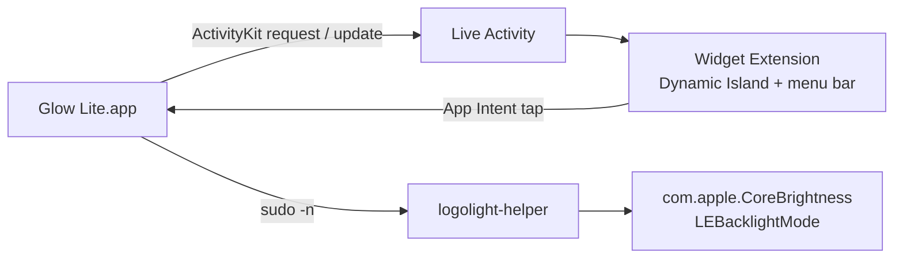

<p align="center">
  
</p>

<p align="center">
  <a href="https://github.com/Lostnal/glow-lite/releases"></a>
  
  
  
</p>

<p align="center">
  <b>Toggle the glowing Apple logo on a PROLED XDR MacBook Pro —<br>right from the macOS Dynamic Island.</b>
</p>

<p align="center">
  <a href="README.zh-CN.md">中文说明</a> ·
  <a href="docs/RELEASE.md">Release guide</a> ·
  <a href="CONTRIBUTING.md">Contributing</a>
</p>

---

## Demo

<p align="center">
  
</p>

Glow Lite is a small native macOS app built on **ActivityKit** and **WidgetKit**. It publishes a Live Activity, so the control lives in the system **Dynamic Island** — no custom floating window, no private APIs.

> **No prebuilt `.app` or `.dmg` yet.** The Live Activity extension must be signed, and distributing a binary to other Macs requires Developer ID + notarization. See [Why is there no prebuilt app or DMG?](#why-is-there-no-prebuilt-app-or-dmg) for the full explanation.

## Features

- **Native Live Activity** — compact and expanded presentations rendered by the system.
- **One control** — tap the Apple in the expanded island to toggle the light.
- **Predictable timing** — dismisses 3 seconds after the last tap; 15 seconds of inactivity also dismisses it.
- **Dock or menu bar** — keep the app in the Dock, or run it as a menu-bar-only accessory.
- **Finish preview** — preview space black / silver enclosure colors, or follow the current Mac.
- **Offline by design** — no network access, no analytics, no telemetry.

## Requirements

| | |
| --- | --- |
| OS | **macOS 27.3+** (currently in beta) |
| Hardware | Apple Silicon + a **PROLED XDR** MacBook Pro for the visible light effect |
| Build | **Xcode 27.3+** with the macOS 27.3 SDK (Command Line Tools alone are not enough) |
| Signing | An **Apple Development** certificate for the Widget Extension |

> On Macs without the PROLED XDR display the app still runs, but toggling the light has no visible effect.

## Build from source

There is no download button that "just works" yet. The supported path is to build locally, because the Live Activity extension has to be signed by a team and the app installs a privileged helper.

### 1. Check your Xcode

```bash
xcodebuild -version
xcode-select -p
```

`xcodebuild -version` must report **Xcode 27.3 or newer**. `xcode-select -p` should point at that Xcode. If it points at an older install:

```bash
sudo xcode-select -s /Applications/Xcode-beta.app/Contents/Developer
```

You can skip the `sudo xcode-select` and pass `DEVELOPER_DIR` to the build script instead.

### 2. Clone the repository

```bash
git clone https://github.com/Lostnal/glow-lite.git
cd glow-lite
```

### 3. Find your signing identity

```bash
security find-identity -v -p codesigning
```

Copy the full `Apple Development: Your Name (TEAMID)` string. You need this certificate for the Widget Extension; an ad-hoc build may produce an app whose Live Activity never appears.

### 4. Build

```bash
DEVELOPER_DIR=/Applications/Xcode-beta.app/Contents/Developer \
CODESIGN_ID="Apple Development: Your Name (TEAMID)" \
./build.sh
```

- `DEVELOPER_DIR` is optional if `xcode-select` already points at Xcode 27.3+. You can also use `XCODE_APP=/Applications/Xcode-beta.app`.
- `CODESIGN_ID` defaults to ad-hoc (`-`). Ad-hoc is fine for reading the source, but the extension usually will not load, so the island will not show.
- The script runs the icon generator, compiles the app and extension, generates `Metadata.appintents` for both targets, signs the bundle, and writes `dist/Glow Lite.app`.

### 5. Install and register the extension

```bash
ditto "dist/Glow Lite.app" "/Applications/Glow Lite.app"
pluginkit -a "/Applications/Glow Lite.app/Contents/PlugIns/GlowWidget.appex"
open "/Applications/Glow Lite.app"
```

- If `ditto` reports a permission error, use `sudo ditto …`.
- `pluginkit -a` registers the Widget Extension. Skipping it can leave the island empty even when the app runs.
- On first launch the app asks for an administrator password once to install the helper described in [Security](#security).

### 6. Verify

```bash
codesign -v "/Applications/Glow Lite.app"
pluginkit -m -i com.local.glowlite.widget
```

Then click the Dock icon, tap the island, and tap the Apple. If something is off:

```bash
log show --last 2m --predicate 'process == "GlowWidget" OR process == "GlowLite"'
```

### Troubleshooting

| Symptom | Likely cause | Fix |
| --- | --- | --- |
| App opens, island never appears | Extension not signed or not registered | Rebuild with an Apple Development certificate, then `pluginkit -a …/GlowWidget.appex` |
| “Glow Lite is damaged” / Gatekeeper blocks it | Ad-hoc or Apple Development signature, quarantine | Build locally, or use a Developer ID + notarized build |
| Light does not change | Mac lacks the PROLED XDR display | Expected on other models |
| Admin prompt on every launch | Helper was declined or removed | Approve once, or use the per-click fallback |
| `build.sh` says no Xcode 27.3+ | `xcode-select` points at an older Xcode | Set `DEVELOPER_DIR` or use `xcode-select -s` |

## Usage

1. Click the **Glow Lite** Dock icon (or the menu bar icon) to start/refresh the Live Activity.
2. The island appears in the compact state; tap it to expand.
3. Tap the **Apple** to switch the light on/off.
4. It dismisses **3 seconds after your last tap**, or after **15 seconds** with no interaction.
5. Right-click the Dock icon for the opposite action, settings, and quit.

## How it works



The actual command is the documented Apple switch:

| Action | Command |
| --- | --- |
| Off | `sudo defaults write com.apple.CoreBrightness LEBacklightMode -int 0` |
| On | `sudo defaults delete com.apple.CoreBrightness LEBacklightMode` |

The helper performs read → toggle → verify inside a single root process, so the UI and the hardware state cannot drift apart.

## Security

The first launch asks for an administrator password once and installs a small helper:

| Path | Purpose |
| --- | --- |
| `/usr/local/libexec/logolight-helper` | root-owned script; accepts only `read` / `toggle` |
| `/private/etc/sudoers.d/logolight` | `your-user ALL=(root) NOPASSWD: /usr/local/libexec/logolight-helper` |

The sudoers file is validated with `visudo -cf` during installation. If you decline, the app falls back to asking for authorization on every toggle.

To remove everything:

```bash
sudo rm -f /usr/local/libexec/logolight-helper /private/etc/sudoers.d/logolight
```

See [SECURITY.md](SECURITY.md) for the threat model and reporting instructions.

## Why is there no prebuilt app or DMG?

This is deliberate, not an oversight:

1. **The Widget Extension must be signed.** Ad-hoc builds can run the app, but macOS often refuses to load an ad-hoc Live Activity extension. A binary that opens but never shows the island would be worse than no binary.
2. **Distribution needs a paid Apple Developer account.** Making a double-clickable app for other Macs requires a **Developer ID Application** certificate, hardened runtime, notarization, and stapling. This project does not have that certificate, so it cannot produce a trustworthy DMG.
3. **macOS 27.3 is still beta.** Live Activity APIs and behavior may change before release; a binary built today could break tomorrow.
4. **The feature is hardware-specific.** Only PROLED XDR MacBook Pros have the glowing logo; a generic binary would mislead most users.
5. **The app installs a sudoers helper.** Building from source lets you audit exactly what runs as root before installing it.

If you have a Developer ID certificate, `release.sh` performs the whole flow (build → DMG → notarize → staple) and [docs/RELEASE.md](docs/RELEASE.md) documents it. Once such a build exists, it can be attached to a GitHub Release.

## Limitations

- The expanded Dynamic Island is **system-controlled**; apps cannot force it open. The app starts the activity, then the user taps to expand.
- The system draws the expanded card with its own fixed margins; a 31:21.6 lid cannot have equal top/bottom and left/right margins inside it.
- The 15-second timer starts when the activity is shown; expand/collapse gestures are not exposed to apps.
- macOS 27.3 is in beta; Live Activity behavior may change before release.
- Tested only on Mac17,13 (M5 Pro, PROLED XDR).

## FAQ

**The island never appears.**
The Widget Extension is probably not signed or not registered. Use an Apple Development certificate, rebuild, then run `pluginkit -a "…/GlowWidget.appex"`.

**The logo does not change.**
Your Mac likely lacks the PROLED XDR display. The command is accepted but has no visible effect on other models.

**Why does it ask for an admin password?**
It installs the fixed helper described in [Security](#security). You can decline and use per-click authorization instead, or uninstall it at any time.

**Does it work on Intel or macOS 26?**
No. It is arm64-only and requires macOS 27.3+.

## Contributing

Issues and pull requests are welcome. Please read [CONTRIBUTING.md](CONTRIBUTING.md) first, and include your macOS version, Mac model, and Xcode version in bug reports.

## License

[MIT](LICENSE).

## Disclaimer

Not affiliated with, endorsed by, or sponsored by Apple Inc. Apple, MacBook Pro, Dynamic Island, and the Apple logo are trademarks of Apple Inc. This project is intended for personal use on hardware you own.
