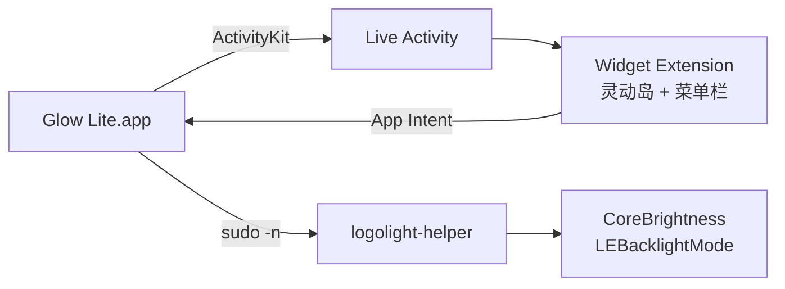

<p align="center">
  
</p>

<p align="center">
  <b>在 macOS 灵动岛里开关 PROLED XDR MacBook Pro 上盖发光的 Apple Logo。</b>
</p>

<p align="center">
  <a href="README.md">English</a> ·
  <a href="docs/RELEASE.md">发布说明</a> ·
  <a href="CONTRIBUTING.md">参与贡献</a>
</p>

---

## 演示

<p align="center">
  
</p>

Glow Lite 是一个基于 **ActivityKit** 和 **WidgetKit** 的原生 macOS App。它发布一个 Live Activity，把控制入口放进系统**灵动岛**——没有自绘悬浮窗，也没有私有 API。

## 功能

- **原生 Live Activity**：紧凑态和展开态都由系统渲染。
- **一个控件**：点展开后的苹果即可切换灯光。
- **固定规则**：最后一次点击后 3 秒收起；15 秒无操作也会收起。
- **程序坞或菜单栏**：可以常驻程序坞，也可以只留菜单栏。
- **机身颜色预览**：星空黑 / 银白 / 跟随本机。
- **完全离线**：不联网、不收集数据、没有遥测。

## 环境要求

| | |
| --- | --- |
| 系统 | **macOS 27.3+**（目前为 Beta） |
| 硬件 | Apple Silicon，以及带 **PROLED XDR** 显示屏的 MacBook Pro |
| 构建 | **Xcode 27.3+**（macOS 27.3 SDK） |
| 签名 | 给 Widget Extension 使用的 **Apple Development** 证书 |

> 其他 Mac 上 App 也能运行，但开关灯没有可见效果。

## 安装

目前不提供预编译二进制，请从源码构建：

```bash
git clone https://github.com/Lostnal/glow-lite.git
cd glow-lite

DEVELOPER_DIR=/Applications/Xcode-beta.app/Contents/Developer \
CODESIGN_ID="Apple Development: Your Name (TEAMID)" \
./build.sh

ditto "dist/Glow Lite.app" "/Applications/Glow Lite.app"
open "/Applications/Glow Lite.app"
```

- `build.sh` 会自动查找 Xcode 27.3+，也可以用 `DEVELOPER_DIR` / `XCODE_APP` 指定。
- `CODESIGN_ID` 默认是 ad-hoc；ad-hoc 构建的 Widget Extension 可能不会被系统加载，灵动岛就不会出现。
- 用 `security find-identity -v -p codesigning` 查看可用证书。

## 使用

1. 点程序坞图标（或菜单栏图标）启动/刷新 Live Activity。
2. 灵动岛先以紧凑态出现，点一下展开。
3. 点里面的**苹果**切换灯光。
4. **最后一次点击后 3 秒**收起；**15 秒**无操作也会收起。
5. 右键程序坞图标：反向动作、设置、退出。

## 原理



实际命令就是 Apple 支持文档里的两个：

| 动作 | 命令 |
| --- | --- |
| 关灯 | `sudo defaults write com.apple.CoreBrightness LEBacklightMode -int 0` |
| 开灯 | `sudo defaults delete com.apple.CoreBrightness LEBacklightMode` |

## 安全说明

首次启动会请求一次管理员授权，安装一个固定的小助手：

| 路径 | 作用 |
| --- | --- |
| `/usr/local/libexec/logolight-helper` | root 所有的脚本，只接受 `read` / `toggle` |
| `/private/etc/sudoers.d/logolight` | `你的用户名 ALL=(root) NOPASSWD: /usr/local/libexec/logolight-helper` |

安装时用 `visudo -cf` 校验。拒绝授权时，App 会退回每次点击都授权的模式。

彻底卸载：

```bash
sudo rm -f /usr/local/libexec/logolight-helper /private/etc/sudoers.d/logolight
```

## 构建与分发

构建：

```bash
DEVELOPER_DIR=/Applications/Xcode-beta.app/Contents/Developer \
CODESIGN_ID="Apple Development: Your Name (TEAMID)" \
./build.sh
```

对外分发需要 **Developer ID Application** 证书并公证：

```bash
CODESIGN_ID="Developer ID Application: Your Name (TEAMID)" \
NOTARY_PROFILE="glow-lite" \
./release.sh
```

详见 [docs/RELEASE.md](docs/RELEASE.md)。App Store 不可行（需要 root 并安装 sudoers 文件）。

## 已知限制

- 展开灵动岛由**系统手势**触发，App 不能强制展开。
- 系统展开卡片尺寸固定，31:21.6 的机盖无法在卡片里做到四边等宽。
- 15 秒计时从活动出现开始，系统不暴露展开/收起事件。
- macOS 27.3 仍为 Beta。
- 仅在 Mac17,13（M5 Pro，PROLED XDR）上测试过。

## 参与贡献

欢迎 Issue 和 PR，请先读 [CONTRIBUTING.md](CONTRIBUTING.md)。提 Bug 时请附上 macOS 版本、Mac 型号和 Xcode 版本。

## License

[MIT](LICENSE)。

## 声明

本项目与 Apple Inc. 无关联，也未获其背书。Apple、MacBook Pro、Dynamic Island 和 Apple Logo 是 Apple Inc. 的商标。本项目仅供在你拥有的硬件上个人使用。
