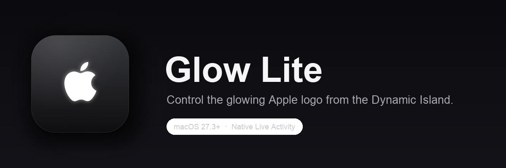
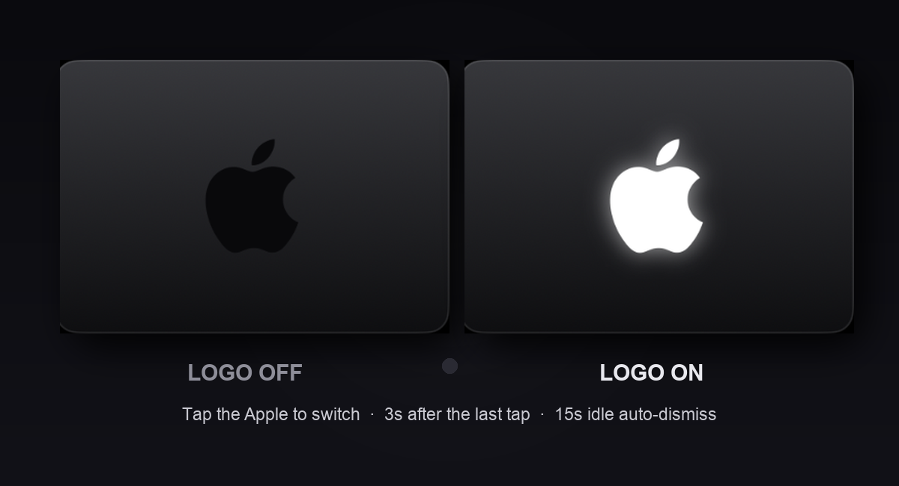
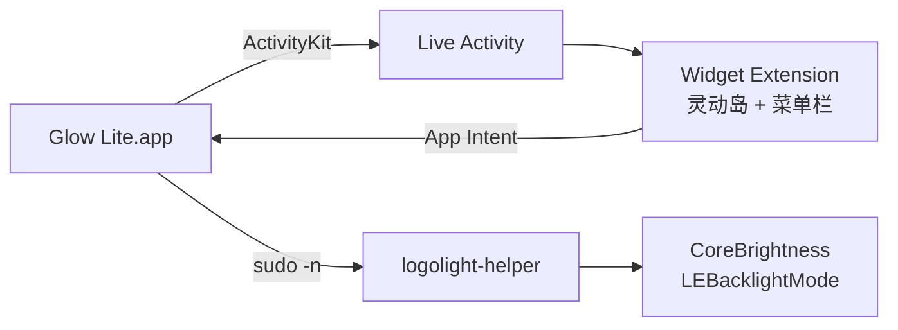

<p align="center">
  
</p>

<p align="center">
  
  
  
</p>

<p align="center">
  <b>在 macOS 灵动岛里开关 PROLED XDR MacBook Pro 上盖发光的 Apple Logo。</b>
</p>

<p align="center">
  <a href="README.md">English</a> ·
  <a href="docs/RELEASE.md">发布说明</a> ·
  <a href="CONTRIBUTING.md">参与贡献</a>
</p>

---

## 演示

<p align="center">
  
</p>

Glow Lite 是一个基于 **ActivityKit** 和 **WidgetKit** 的原生 macOS App。它发布一个 Live Activity，把控制入口放进系统**灵动岛**——没有自绘悬浮窗，也没有私有 API。

> **目前没有预编译的 `.app` 或 `.dmg`。** Live Activity 扩展必须签名，而给别人的 Mac 分发二进制还需要 Developer ID + 公证。原因见 [为什么没有预编译版本？](#为什么没有预编译版本)。

## 功能

- **原生 Live Activity**：紧凑态和展开态都由系统渲染。
- **一个控件**：点展开后的苹果即可切换灯光。
- **固定规则**：最后一次点击后 3 秒收起；15 秒无操作也会收起。
- **程序坞或菜单栏**：可以常驻程序坞，也可以只留菜单栏。
- **机身颜色预览**：星空黑 / 银白 / 跟随本机。
- **完全离线**：不联网、不收集数据、没有遥测。

## 环境要求

| | |
| --- | --- |
| 系统 | **macOS 27.3+**（目前为 Beta） |
| 硬件 | Apple Silicon，以及带 **PROLED XDR** 显示屏的 MacBook Pro |
| 构建 | **Xcode 27.3+**（macOS 27.3 SDK；只有命令行工具不够） |
| 签名 | 给 Widget Extension 使用的 **Apple Development** 证书 |

> 其他 Mac 上 App 也能运行，但开关灯没有可见效果。

## 从源码构建

目前没有“下载就能双击”的版本，推荐直接本地构建：Live Activity 扩展需要签名，App 还会安装一个特权小助手。

### 1. 确认 Xcode 版本

```bash
xcodebuild -version
xcode-select -p
```

`xcodebuild -version` 必须是 **Xcode 27.3 或更高**；`xcode-select -p` 要指向这个 Xcode。如果指向旧版本：

```bash
sudo xcode-select -s /Applications/Xcode-beta.app/Contents/Developer
```

不想改全局 `xcode-select` 的话，也可以在构建时传 `DEVELOPER_DIR`。

### 2. Clone 源码

```bash
git clone https://github.com/Lostnal/glow-lite.git
cd glow-lite
```

### 3. 找到签名证书

```bash
security find-identity -v -p codesigning
```

复制完整的 `Apple Development: 你的名字 (TEAMID)`。Widget Extension 需要这个证书；ad-hoc 构建出来的 App 通常不会加载扩展。

### 4. 编译

```bash
DEVELOPER_DIR=/Applications/Xcode-beta.app/Contents/Developer \
CODESIGN_ID="Apple Development: 你的名字 (TEAMID)" \
./build.sh
```

- 如果 `xcode-select` 已经指向 Xcode 27.3+，`DEVELOPER_DIR` 可以省略；也可以用 `XCODE_APP=/Applications/Xcode-beta.app`。
- `CODESIGN_ID` 默认是 ad-hoc（`-`）。ad-hoc 可以编译，但扩展通常加载不了，灵动岛不会出现。
- 脚本会生成图标、编译 App 和扩展、给两个 target 生成 `Metadata.appintents`、签名，最后输出 `dist/Glow Lite.app`。

### 5. 安装并注册扩展

```bash
ditto "dist/Glow Lite.app" "/Applications/Glow Lite.app"
pluginkit -a "/Applications/Glow Lite.app/Contents/PlugIns/GlowWidget.appex"
open "/Applications/Glow Lite.app"
```

- `ditto` 报权限错误就加 `sudo`。
- `pluginkit -a` 用来注册 Widget Extension；不注册的话，即使 App 运行，灵动岛也可能一直是空的。
- 首次启动会请求一次管理员授权，安装 [安全说明](#安全说明) 里的助手。

### 6. 验证

```bash
codesign -v "/Applications/Glow Lite.app"
pluginkit -m -i com.local.glowlite.widget
```

然后点程序坞图标、点开灵动岛、点苹果。如果不对：

```bash
log show --last 2m --predicate 'process == "GlowWidget" OR process == "GlowLite"'
```

### 常见构建问题

| 现象 | 原因 | 解决 |
| --- | --- | --- |
| App 能开，灵动岛不出现 | 扩展没签名 / 没注册 | 用 Apple Development 证书重编，再 `pluginkit -a …/GlowWidget.appex` |
| “已损坏” / 被 Gatekeeper 拦 | ad-hoc 或 Apple Development 签名 + quarantine | 本地构建，或做 Developer ID + 公证 |
| 灯没变化 | 不是 PROLED XDR 机型 | 正常现象 |
| 每次启动都弹管理员授权 | 助手被拒绝或删掉了 | 授权一次，或接受每次授权模式 |
| `build.sh` 说找不到 Xcode 27.3+ | `xcode-select` 指向旧 Xcode | 设置 `DEVELOPER_DIR` 或 `xcode-select -s` |

## 使用

1. 点程序坞图标（或菜单栏图标）启动/刷新 Live Activity。
2. 灵动岛先以紧凑态出现，点一下展开。
3. 点里面的**苹果**切换灯光。
4. **最后一次点击后 3 秒**收起；**15 秒**无操作也会收起。
5. 右键程序坞图标：反向动作、设置、退出。

## 原理



实际命令就是 Apple 支持文档里的两个：

| 动作 | 命令 |
| --- | --- |
| 关灯 | `sudo defaults write com.apple.CoreBrightness LEBacklightMode -int 0` |
| 开灯 | `sudo defaults delete com.apple.CoreBrightness LEBacklightMode` |

## 安全说明

首次启动会请求一次管理员授权，安装一个固定的小助手：

| 路径 | 作用 |
| --- | --- |
| `/usr/local/libexec/logolight-helper` | root 所有的脚本，只接受 `read` / `toggle` |
| `/private/etc/sudoers.d/logolight` | `你的用户名 ALL=(root) NOPASSWD: /usr/local/libexec/logolight-helper` |

安装时用 `visudo -cf` 校验。拒绝授权时，App 会退回每次点击都授权的模式。

彻底卸载：

```bash
sudo rm -f /usr/local/libexec/logolight-helper /private/etc/sudoers.d/logolight
```

## 为什么没有预编译版本？

这是有意为之：

1. **Widget Extension 必须签名。** ad-hoc 构建能让 App 启动，但系统经常不加载 ad-hoc 的 Live Activity 扩展；一个“能打开但永远没有灵动岛”的包，比没有包更糟。
2. **对外分发需要付费开发者账号。** 要让别人的 Mac 双击就能打开，需要 **Developer ID Application** 证书 + hardened runtime + 公证 + staple。本项目没有这个证书，所以无法产出可信的 DMG。
3. **macOS 27.3 还是 Beta。** Live Activity 的行为随时可能变，今天打的包明天可能就失效。
4. **功能依赖特定硬件。** 只有 PROLED XDR MacBook Pro 有发光 Logo；通用二进制会误导大多数用户。
5. **App 会安装 sudoers 助手。** 从源码构建，你可以在把它装进系统之前先审查它到底以 root 身份做什么。

如果你有 Developer ID 证书，`release.sh` 会完成 构建 → DMG → 公证 → staple 的全流程，见 [docs/RELEASE.md](docs/RELEASE.md)。做出这样的包之后，才可以挂到 GitHub Release。

## 已知限制

- 展开灵动岛由**系统手势**触发，App 不能强制展开。
- 系统展开卡片尺寸固定，31:21.6 的机盖无法在卡片里做到四边等宽。
- 15 秒计时从活动出现开始，系统不暴露展开/收起事件。
- macOS 27.3 仍为 Beta。
- 仅在 Mac17,13（M5 Pro，PROLED XDR）上测试过。

## 参与贡献

欢迎 Issue 和 PR，请先读 [CONTRIBUTING.md](CONTRIBUTING.md)。提 Bug 时请附上 macOS 版本、Mac 型号和 Xcode 版本。

## License

[MIT](LICENSE)。

## 声明

本项目与 Apple Inc. 无关联，也未获其背书。Apple、MacBook Pro、Dynamic Island 和 Apple Logo 是 Apple Inc. 的商标。本项目仅供在你拥有的硬件上个人使用。
